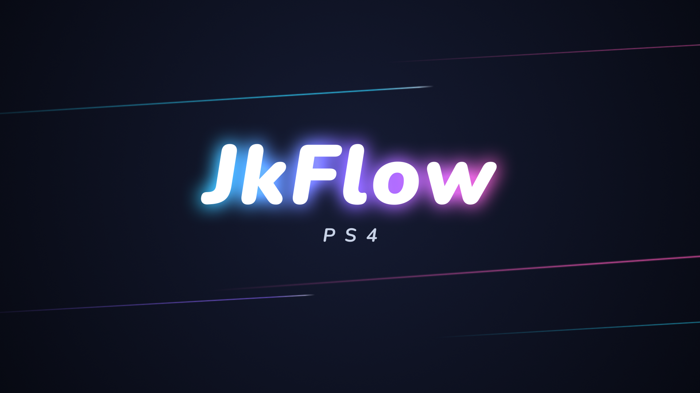

# JkFlow

[](https://github.com/Salru13/JkFlow/releases)
[](https://hits.sh/github.com/Salru13/JkFlow/)




JkFlow runs your own copy of Blur (PC) on a PS4. This repository holds the
source of the JkFlow launcher, the title integration recipe and the package
texts of JkFlow 1.00. The player guide is `README-player.md`.

## Getting started

You need a PS4 with GoldHEN, an FTP client on your computer and your own copy of Blur (PC).

1. Download `JkFlow-1.00.pkg` from [Releases](https://github.com/Salru13/JkFlow/releases), install it with GoldHEN and open JkFlow once.
2. Copy all your Blur files over FTP into `/data/JkFlow/Blur`. `Blur.exe` must be directly in that folder.
3. In JkFlow, open **Patch** and choose **Patch for offline play**, or **Patch for online play (AMAX)** to also download the AMAX online client.
4. Press **Play**.

### Offline patch or online patch

| | Patch for offline play | Patch for online play (AMAX) |
|---|---|---|
| What it installs | Only the JkFlow files. Your own `Blur.exe` stays. | The JkFlow files plus the AMAX online client and Blur 1.2, downloaded from amax-emu.com. |
| Internet | Not needed | Needed (or put the two zips in `/data/JkFlow` yourself, see Help) |
| Play | Career and split screen | Online, career and split screen |
| Frame rate | 60 FPS only with a verified `Blur.exe` | 60 FPS can be turned on, also if your own `Blur.exe` was not verified: the online patch puts in the verified Blur 1.2 |

A `Blur.exe` that JkFlow does not recognise always runs at 30 FPS. If that is your case and you have a PS4 Pro, run **Patch for online play** once; after that **Settings > frame rate** lets you choose 60 FPS. **Patch for offline play** puts your own `Blur.exe` back at any time.

### Online play

1. Create an account on the AMAX website: [amax-emu.com/how_to_play](https://amax-emu.com/how_to_play).
2. In JkFlow, open **Patch** and choose **Patch for online play (AMAX)**. It downloads the AMAX online client.
3. Open **Settings > online account (AMAX)** and type the **username** and **password** you created on the AMAX website, then choose **Save**. JkFlow keeps them on the PS4, and Blur signs in with them.
4. Press **Play** and choose online in Blur.

### Settings

| Setting | What it does |
|---|---|
| **frame rate** | 30 FPS (default, recommended for PS4 and PS4 Slim) or 60 FPS (PS4 Pro with Boost Mode, verified Blur). Split screen always runs at 30 FPS. |
| **online account (AMAX)** | Your AMAX username and password for online play. **Remove account** deletes them. |
| **show fps / ms** | Shows the frame rate and frame time on screen during the game. |
| **enable logs** | Writes detailed logs while you play. Leave it off unless you are tracking down a problem. |
| **save support bundle** | Collects the logs and your settings into one folder; copy it to a PC over FTP if someone helps you with a problem. |

The full guide is [README-player.md](README-player.md).

## Repository layout

| Path | What |
|---|---|
| `launcher/` | The JkFlow launcher UI: Start carousel, Patch, settings, help, its own on-screen keyboard and the loader shown while the game starts. It covers UI only: it calls no PS4 API and does not touch the game engine, DXVK, the network layer or the packaging. The title plugs it in through a table of service callbacks (`bl_frontend_run`). |
| `title/` | The title integration recipe: `prepare_blur100.py` prepares the title tree and applies `r1/title-r1.patch`, `prod-audit/title-prod.patch` and `title-blur100.patch`; `postlink_clean.py` and `postlink_devpaths.py` are the post-link cleans; `make_package_inputs.sh` prepares the package inputs; `tests/` holds the title host tests. See `title/README.md`. |
| `mesa/` | The PS4 window-system patches for Mesa (MIT). See `mesa/README.md`. |
| `wine/` | The Wine PS4 runtime source (see `wine/README.md`). |
| `LICENSE`, `THIRD_PARTY.md`, `SOURCES.txt`, `LICENSES/` | The licence texts shipped in the package. |

### Launcher

| Path | What |
|---|---|
| `launcher/src/bl_ui.h/.c` | Software renderer: glass cards and panels, pills, light trails, glow, additive logo, text, background. Frame format BGRX. |
| `launcher/tools/bake_assets.sh` | Generates `bl_font.h`, `bl_font_data.c` (Nunito glyph atlases) and `bl_logo.c` into a build directory. The outputs are not committed. |
| `launcher/tools/bake_font.c` | FreeType-based atlas baker. Nunito is a variable font: Black = weight 900, ExtraBold = weight 800. |
| `launcher/tools/make_art.c` | Draws JkFlow's own artwork (typographic wordmark in Nunito, "PS4", neon streaks): `launcher/assets/sce_sys/icon0.png`, `pic0.png`, `pic1.png`; and `logo.png` (on black), installed as `launcher/assets/logo/blur-icon0.png`. No official Blur artwork is used. |
| `launcher/tools/bake_logo.py` | Crops the wordmark out of `launcher/assets/logo/blur-icon0.png`, with feathered edges. |
| `launcher/tools/make_manifest.py` | Writes the Patch manifest of the package's `blur-files`. |
| `launcher/tools/scan_names.py` | Name and path scanner for package trees. Private names (for example build-host account names) are read from a file given with `--private` or `SCAN_NAMES_PRIVATE`; `launcher/tools/scan-names-private.example` is an empty example. |
| `launcher/assets/font/` | Nunito, SIL OFL 1.1 (`OFL.txt`). Downloaded from `github.com/google/fonts` `ofl/nunito` on 2026-11-13. `Nunito-VF.ttf` sha256 `bb55a5ca…5207`, `Nunito-Italic-VF.ttf` sha256 `b520cc87…29c8`. |
| `launcher/assets/blur-files/` | Files Patch installs into the player's Blur folder: `model-base.ini` and the account plugin for the online overlay. |
| `launcher/tests/run.sh` | Builds the assets and runs every `launcher/tests/test_*.c` with ASan and UBSan, then the `test_*.sh` checks (Linux). The screen tests compare rendered frames with `launcher/tests/golden/*.sha256`. |
| `launcher/tests/preview_ui.c` | Writes PNG previews of the primitives. |

## Build and test (Linux)

```bash
FREETYPE_INCLUDE=<FreeType include dir> bash launcher/tests/run.sh
```

Needs a C compiler with ASan/UBSan, Python 3 and FreeType. `FREETYPE_INCLUDE`
(default `/usr/include/freetype2`) names the FreeType headers and
`FREETYPE_LIB` (default `/usr/lib/x86_64-linux-gnu/libfreetype.so.6`) the
library (see `launcher/tools/bake_assets.sh`). The screen goldens were made with
FreeType 2.13.

## Licence

The launcher code is LGPL-2.1-or-later (see `LICENSE`; the V7/S7 DLLs are
separate files, all rights reserved, and are not in this repository).
Native DXVK (our changes in `dxvknative.prx` and `d3d9.c988.dll`) is free to
use with the credit line "Native DXVK by XxXJoker13XxX"
(`LICENSES/JkFlow-Native-DXVK.txt`).
Third-party components and their licences are listed in `THIRD_PARTY.md`.

## Credits

- [orbis-win](https://github.com/plastikman/orbis-win) and the PS4 Wine port by [plastikman](https://github.com/plastikman). JkFlow's Wine runtime is built from them.
- The original Wine console port by [mpereiraesaa](https://github.com/mpereiraesaa).
- [orbis-compat](https://github.com/orbis-ports) by Mikołaj Mikołajczyk, the [OpenOrbis](https://github.com/OpenOrbis) toolchain and the [orbis-porting-kit](https://github.com/orbis-ports/orbis-porting-kit) SDK.
- Wine, Mesa/RADV, [DXVK](https://github.com/doitsujin/dxvk) (Philip Rebohle, Joshua Ashton), LLVM and FreeType: the stack underneath. The launcher font is Nunito.
- Online play: the AMAX client and community servers by the AMAX team ([amax-emu.com](https://amax-emu.com)), downloaded by the player.
- The JkFlow launcher, Native DXVK, the V7 frame pacer and the S7 shader fixes by XxXJoker13XxX.
- *Blur* is Activision's. JkFlow is not affiliated with Activision, Bizarre Creations, AMAX or Sony.
